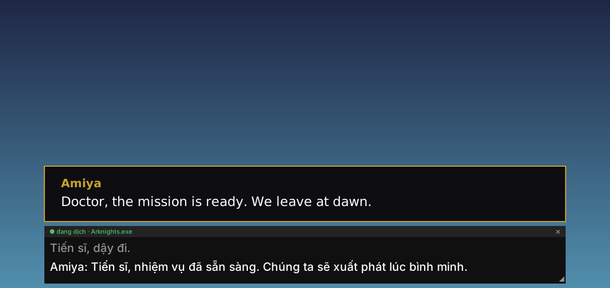
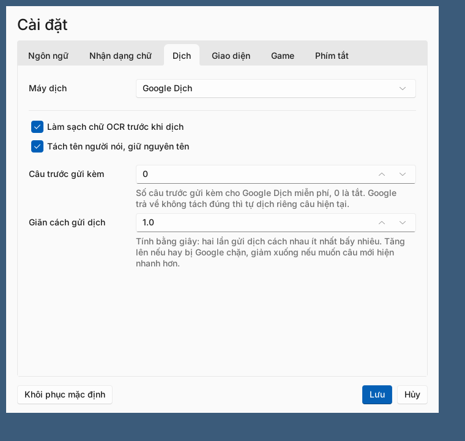

# Screen Translator

**Real-time screen translator for Windows.** Press a hotkey, drag over any part of the screen (game dialogue, video subtitles, chat windows, documents) and the text is read with OCR and translated live, every time it changes. A free, lightweight alternative to Translumo with Google Translate, DeepL and AI translation (Claude, ChatGPT, Gemini, Grok).

**App dịch màn hình theo thời gian thực cho Windows.** Bấm phím tắt, kéo chuột chọn một vùng trên màn hình (khung thoại trong game, phụ đề video, cửa sổ chat, tài liệu...), app tự đọc chữ và hiện bản dịch tiếng Việt mỗi khi chữ thay đổi.

## Tải về

Vào trang **[Releases](https://github.com/DaoLongVu2107/screen_translate/releases/latest)**, tải `ScreenTranslator.exe` rồi chạy. Không cần cài đặt gì thêm.

> Windows có thể hiện cảnh báo SmartScreen vì file chưa có chữ ký số: bấm **More info → Run anyway**.

Yêu cầu: Windows 10 hoặc 11.

## Tính năng

- Chọn vùng bằng phím tắt, dịch liên tục và chỉ dịch khi chữ thay đổi
- Dịch nhanh một lần kiểu Google Lens: khoanh vùng là có bản dịch, kèm nút Copy
- Nhận dạng chữ bằng Windows OCR có sẵn, hoặc Tesseract
- Máy dịch: Google Dịch miễn phí, Google Cloud Translation, DeepL, hoặc AI (Claude, ChatGPT, Gemini, Grok) bằng API key của bạn
- Tự làm sạch lỗi OCR và tách tên người nói, chỉ dịch lời thoại
- Khung dịch kéo đi tự do, đổi kích thước, có lịch sử các câu trước
- Chế độ chuột bấm xuyên qua: khung dịch đè lên game mà vẫn click vào game bình thường
- Hiện viền vùng đang dịch và kéo cạnh, góc để chỉnh trực tiếp, không cần chọn lại từ đầu
- Rê chuột vào chữ gốc để tra nghĩa từng từ theo loại từ
- Nhớ vùng dịch theo từng app, kéo cửa sổ đi đâu vùng dịch theo đó, đổi kích thước cửa sổ thì vùng dịch co giãn theo
- Chỉ dịch khi app đang ở phía trước, thu nhỏ hoặc chuyển cửa sổ thì tự dừng
- Giao diện Sáng / Tối, tùy chỉnh phông chữ, màu, độ trong suốt

## Phím tắt

| Phím | Chức năng |
|---|---|
| `Alt + Q` | Chọn vùng cần dịch (bắt đầu dịch tự động) |
| `Alt + W` | Tạm dừng / tiếp tục dịch |
| `Alt + E` | Dịch lại ngay |
| `Alt + D` | Dịch nhanh một lần: khoanh vùng, xem bản dịch rồi thôi |
| `Alt + H` | Ẩn / hiện khung dịch |
| `Alt + C` | Bật / tắt chuột bấm xuyên qua khung dịch |
| `Alt + R` | Hiện viền vùng đang dịch để kéo chỉnh; bấm lại hoặc `Enter` để lưu, `Esc` để hủy |
| `Alt + S` | Mở cài đặt |
| `Ctrl + Alt + X` | Thoát |

Mọi phím tắt đều đổi được trong phần Cài đặt.

## Cách dùng

1. Chạy `ScreenTranslator.exe`. App nằm ở khay hệ thống (góc phải thanh taskbar).
2. Bấm `Alt + Q`, kéo chuột quanh vùng có chữ cần dịch. Bấm `Esc` hoặc chuột phải để hủy.
3. Bản dịch hiện trong một khung nhỏ ngay dưới vùng đã chọn và tự cập nhật khi chữ thay đổi.
   - Kéo bất kỳ chỗ nào trên khung để di chuyển, kéo góc dưới phải để đổi kích thước.
   - Câu mới hiện ở dưới cùng, câu cũ đẩy lên trên thành lịch sử; lăn chuột để xem lại.
   - Giữ `Ctrl` và lăn chuột trên khung để chỉnh độ trong suốt.
   - Chuột phải vào khung để copy bản dịch, xem chữ gốc, chọn vùng mới...
4. Bấm `Alt + S` (hoặc chuột phải icon ở khay → **Mở cài đặt**) để chỉnh ngôn ngữ, máy dịch, giao diện, phím tắt và cách nhớ vùng theo app.

## Dịch bằng AI

AI dịch tự nhiên hơn hẳn, hiểu mạch hội thoại, xưng hô đúng và giữ tên riêng nhất quán.

1. Mở Cài đặt → tab **Dịch** → chọn một máy dịch AI.
2. Bấm **Lấy key** để mở trang tạo API key của nhà cung cấp, dán key vào ô **API key**.
3. Chọn model (bấm **Tải danh sách** để xem các model mới nhất), rồi bấm **Thử dịch** để kiểm tra.
4. Có thể ghi chú cho AI, ví dụ: *“Doctor dịch là Tiến sĩ; giữ nguyên tên nhân vật”*.

Phí AI tính theo lượng chữ và trả trực tiếp cho nhà cung cấp. App chỉ gọi AI khi chữ trên màn hình thay đổi.

## Mẹo

- **Dịch tiếng Nhật, Trung, Hàn...**: Windows cần có gói ngôn ngữ đó. Vào *Settings → Time & language → Language & region → Add a language* và thêm ngôn ngữ cần đọc.
- **Hay bị Google chặn**: tăng **Giãn cách gửi dịch** trong Cài đặt → Dịch, hoặc chuyển sang Google Cloud, DeepL hay AI.
- **Phím tắt không ăn khi đang dùng một app khác** (thường là game): chuột phải `ScreenTranslator.exe` → *Run as administrator*.
- **Game toàn màn hình**: chuyển game sang chế độ *Borderless* hoặc *Windowed* để khung dịch nổi lên trên được.
- **Nên chọn vùng vừa khít phần chữ**: dịch sẽ nhanh và chính xác hơn.

## Giấy phép

[MIT](LICENSE)
